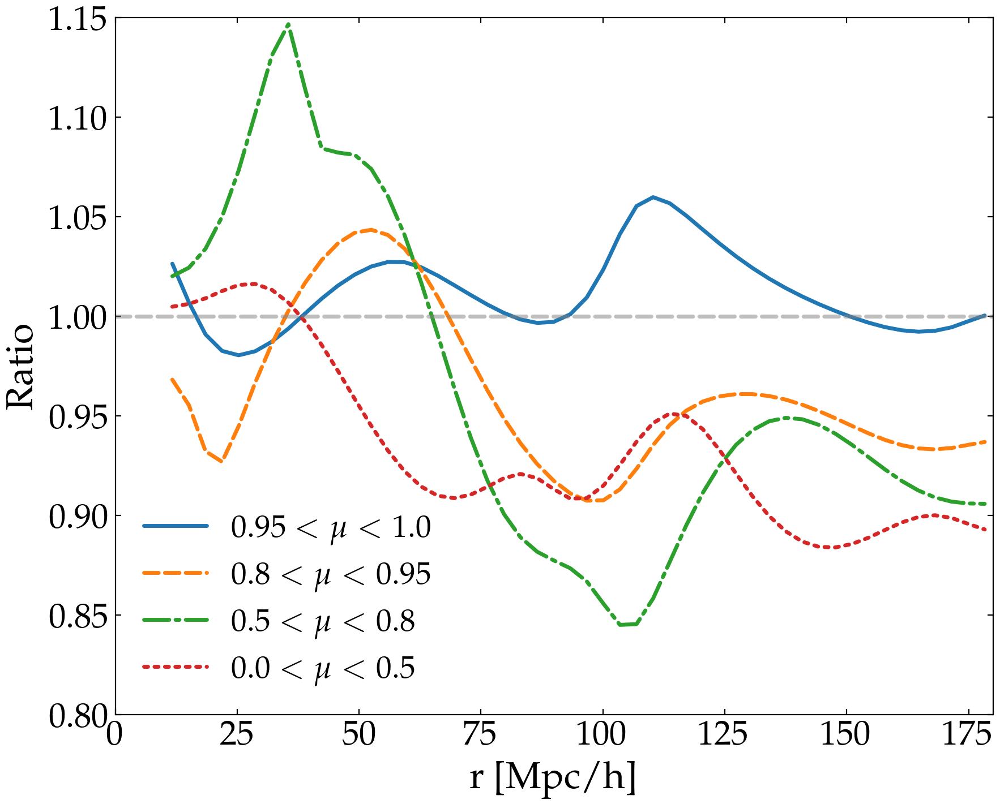
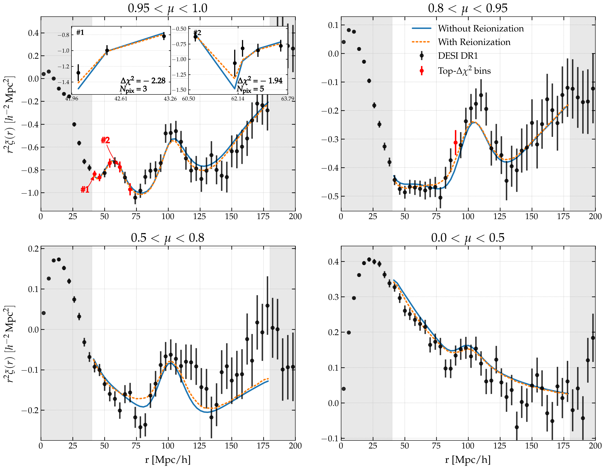

# Reanalysis of DESI results with our reionization model
This folder contains scripts to visualize and analyze the results of Vega for our runs.


## Introduction of files
**5par.mplstyle** is the style file for figures.


**get_best_maximum_likelihood.py** returns the point with the maximum likelihood from the input Polychord chain. The input file is written in hard coded format within the file.


**param_comp.py** does the comparison between the parameters from different runs, for example, base DESI DR1 results and our reproduced DESI DR1 results, by showing them in the same figure. All the parameter values are written in hard coded format.


**plttria_weight.py** makes the contour corner plot for the posterior distribution of free parameters. There are 4 alternative modes: conservative_fid, conservative_yuk, optimistic_fid and optimistic_yuk. Conservative_* modes correspond to lyalya x lyalya autocorrelation, and optimistic modes correspond to all combined correlations. *_fid modes correspond to fiducial model without reionization effect, while *_yuk modes correspond to our reionization model, which induces 3 more reionization parameters. Call it with the command `python analysis/plttria_weight.py /your/path/to/polychord_chains mode`, for example:
```
python analysis/plttria_weight.py /Users/zhengyifan/vega_result/40_180/auto_reio_40_180_3free/Poly_bbt_40_180_auto conservative_yuk
```


**replot_from_fits.py** makes the standard wedge plot from the output file of Minimizer, while it can show two different fit results for comparison. Call it with the command `python analysis/replot_from_fits.py -wedge --fit1 /path/to/fit1.fits --fit2 /path/to/fit2.fits --config path/to/ini_file.ini --corr corr_type --plot-rmin n`, for example:
```
python analysis/replot_from_fits.py -wedge --fit1 /work/zhuxing/vega_result/0318_fid_auto_20-180.fits --fit2 /work/zhuxing/vega_result/0318_yuk_auto_20-180.fits --config analysis/main_minimizer.ini --corr lyaxlya --plot-rmin 20
```


**replot_polychord.py** makes the wedge plot from the output file of Polychord in mode `wedge`, and makes the ratio between two models in mode `compare`. Note that the actual input is the parameter-name file and parameter-value file, this script requires the data file to rebuild the correlation function, so make sure to run it with access to data file. Call it with the command `python analysis/replot_polychord.py -mode --chain1 path/to/polychord/chain1 --chain2 path/to/polychord/chain2 --config1 path/to/config_file/for/chain1 --config2 path/to/config_file/for/chain2 --corr corr_type --plot-rmin n`, for example:
```
python analysis/replot_polychord.py -wedge --chain1 Polychord_result/full_fid_nv --chain2 Polychord_result/full_reio_ep_nv --config1 analysis/main_fid.ini --config2 analysis/main_reio.ini --corr lyaxlya --plot-rmin 10
```
The figure auto_ratio.png is made by this script. 


**separate_chi2.py** can provide you with the chi^2 in the r-range you're interested in, with the input polychord file and required r-range hard coded. You can easily call it with `python analysis/separate_chi2.py`, but remember also to run it with access to data file.


**point_chi2.py** makes similar wedge plot as **replot_polychord.py** does, but it can also show the most contributing-to-delta_chi^2 points with red, and inset to show the contribution of pixels for some of them. It has many arguments to control the inset plots. Call it as the example:
```
python analysis/point_chi2.py --chain-fid Polychord_result/auto_40_fid_bf --chain-reio Polychord_result/auto_40_reio_bf --config-fid analysis/main_fid.ini --config-reio analysis/main_reio.ini --corr lyaxlya --plot-rmin 40 --plot-rmax 180 --top-k 6 --use-mean --zoom
```
It can generate such figure: 
